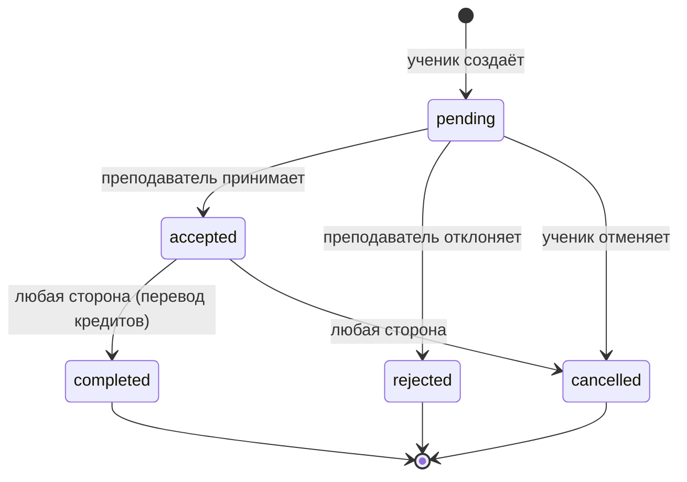
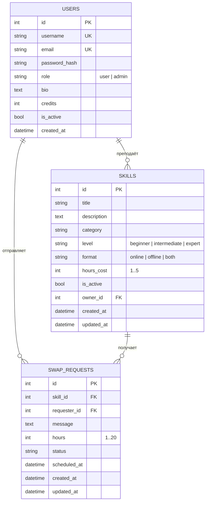
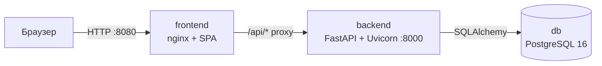

# SkillSwap — описание проекта

## 1. Идея и проблема

Почти каждый человек что-то умеет: говорить по-английски, играть на гитаре, писать на Python, печь хлеб,
настраивать роутер. И почти каждый хочет чему-то научиться. Но платные курсы и репетиторы дороги,
а бесплатные видео не дают живой обратной связи. При этом знания, которые люди могли бы передать друг другу,
просто лежат без дела.

**SkillSwap** — веб-приложение «банк времени» для обмена навыками. Главная валюта платформы — не деньги,
а **время**: проведя час занятия, преподаватель получает **тайм-кредит**, который может потратить на час
обучения у любого другого участника. Так программист учит дизайнера вёрстке, дизайнер учит музыканта
работе в Figma, а музыкант учит программиста играть на гитаре — и никто никому не платит.

### Чем проект уникален

- **Неденежная экономика.** Кредиты нельзя купить — их можно только заработать, делясь знаниями.
  Это поощряет взаимность и делает обучение доступным для студентов, пенсионеров и людей с небольшим доходом.
- **Не нужен прямой встречный интерес.** В классическом бартере «гитара в обмен на английский» нужно найти
  человека с точно зеркальными интересами. Тайм-кредиты снимают это ограничение: учите одного, учитесь у другого.
- **Гибкая цена часа.** Обычный час стоит 1 кредит, а редкий экспертный навык преподаватель может оценить
  до 5 кредитов — это балансирует спрос и предложение.
- **Встроенные гарантии.** Кредиты списываются только после того, как занятие отмечено проведённым;
  заявку нельзя отправить без достаточного баланса; администратор может разрешать спорные ситуации.

### Целевая аудитория

- студенты и молодые специалисты, которые хотят прокачать смежные навыки без затрат;
- эксперты-хоббисты, которым нравится делиться знаниями;
- локальные сообщества (университеты, коворкинги, жители района), где важны офлайн-встречи;
- компании, которые хотят организовать внутренний обмен знаниями между сотрудниками.

## 2. Как это работает

1. Гость открывает каталог, ищет и фильтрует навыки (по названию, категории, уровню, формату).
2. После регистрации пользователь получает **3 стартовых кредита**, чтобы сразу начать учиться.
3. Пользователь публикует свои навыки: название, описание, категорию, уровень, формат (онлайн/офлайн)
   и стоимость часа.
4. Ученик отправляет **заявку на обмен**: выбирает число часов, желаемое время и пишет сообщение.
   Система проверяет, что навык не его собственный, и что на балансе хватает кредитов.
5. Преподаватель **принимает** или **отклоняет** заявку.
6. После занятия любая из сторон отмечает его **проведённым** — кредиты автоматически
   переходят от ученика к преподавателю.

### Жизненный цикл заявки

Удалить заявку ученик может только в статусах `pending`, `rejected` и `cancelled`: история принятых
и завершённых обменов сохраняется. Администратор может удалить любую заявку.

## 3. Роли и права доступа

| Действие | Гость | Пользователь | Администратор |
|---|:-:|:-:|:-:|
| Просмотр и поиск по каталогу | ✔ | ✔ | ✔ |
| Регистрация / вход | ✔ | — | — |
| Создание навыков | | ✔ | ✔ |
| Редактирование / удаление навыков | | только своих | любых |
| Создание заявок | | ✔ (не на свой навык) | ✔ |
| Принятие / отклонение заявки | | как преподаватель | любой |
| Просмотр заявок | | свои (входящие/исходящие) | все |
| Управление пользователями (роль, блокировка, баланс, удаление) | | | ✔ |
| Статистика платформы | | | ✔ |

Авторизация построена на **JWT**: при входе сервер выдаёт подписанный токен с идентификатором
пользователя и ролью, клиент передаёт его в заголовке `Authorization: Bearer <token>`.
Пароли хранятся только в виде хеша **bcrypt**. Заблокированный пользователь не может войти,
а его уже выданный токен перестаёт приниматься. Первый администратор создаётся автоматически
при старте из переменных окружения `ADMIN_USERNAME` / `ADMIN_PASSWORD`.

## 4. Бизнес-сущности

В системе две основные бизнес-сущности, для каждой реализован полный CRUD, и вспомогательная сущность «Пользователь».

**Навык (Skill)** — предложение научить чему-либо.
Create — `POST /api/skills`, Read — `GET /api/skills`, `GET /api/skills/{id}`,
Update — `PUT /api/skills/{id}`, Delete — `DELETE /api/skills/{id}`.

**Заявка на обмен (SwapRequest)** — запрос ученика на N часов обучения конкретному навыку.
Create — `POST /api/swaps`, Read — `GET /api/swaps`, `GET /api/swaps/{id}`,
Update — `PUT /api/swaps/{id}` (изменение полей и смена статуса), Delete — `DELETE /api/swaps/{id}`.

## 5. Архитектура

Приложение состоит из трёх Docker-контейнеров, которые поднимаются одной командой `docker compose up`:

| Контейнер | Технологии | Назначение |
|---|---|---|
| `db` | PostgreSQL 16 (alpine) | Хранение данных; том `pgdata` сохраняет данные между перезапусками; healthcheck через `pg_isready` |
| `backend` | Python 3.12, FastAPI, SQLAlchemy 2, Pydantic 2, PyJWT, bcrypt | REST API, бизнес-логика, авторизация; стартует только после того, как БД стала healthy |
| `frontend` | nginx 1.27, HTML/CSS/JavaScript (SPA без сборки) | Отдаёт интерфейс и проксирует `/api/*` в backend, поэтому нет проблем с CORS |

Ключевые решения:
- **FastAPI** даёт автоматическую валидацию запросов через Pydantic и интерактивную документацию Swagger (`/api/docs`).
- **Таблицы создаются при старте** (`create_all`), а демо-данные (пользователи `anna`, `ivan` и 4 навыка)
  добавляются, только если каталог пуст, — проект можно показать сразу после запуска.
- **Перевод кредитов** выполняется в той же транзакции, что и смена статуса заявки на `completed`,
  поэтому баланс не может разойтись.
- **Каскадное удаление**: удаление навыка удаляет его заявки, удаление пользователя — его навыки и заявки.

## 6. Тестирование

В `backend/tests/test_api.py` находится сквозной тест, который проходит весь сценарий:
регистрация и вход, CRUD навыков с проверкой прав, CRUD заявок с проверкой бизнес-правил
(свой навык, нехватка кредитов, дубликаты, недопустимые переходы статусов), перевод кредитов,
функции администратора и блокировка пользователя. Тест запускается на SQLite без Docker.

## 7. Развитие проекта

Ближайший бэклог (подробно — в [USE_CASES.md](USE_CASES.md)): отзывы и рейтинг преподавателей,
чат внутри заявки, уведомления в Telegram и по email, расписание доступности, жалобы и их модерация,
прямой обмен «навык на навык», миграции схемы через Alembic, CI-пайплайн в GitHub Actions.
