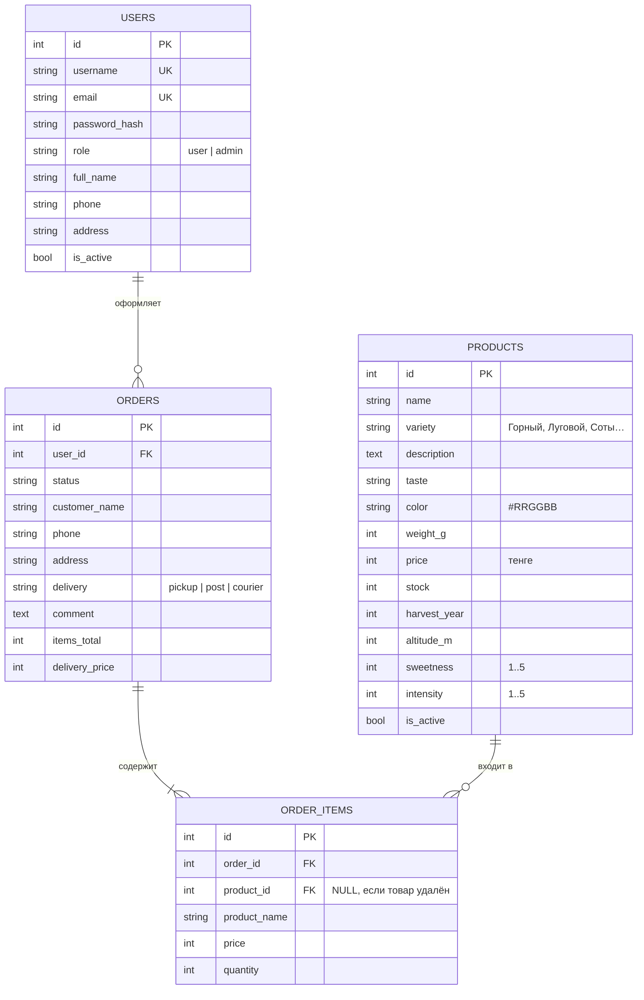
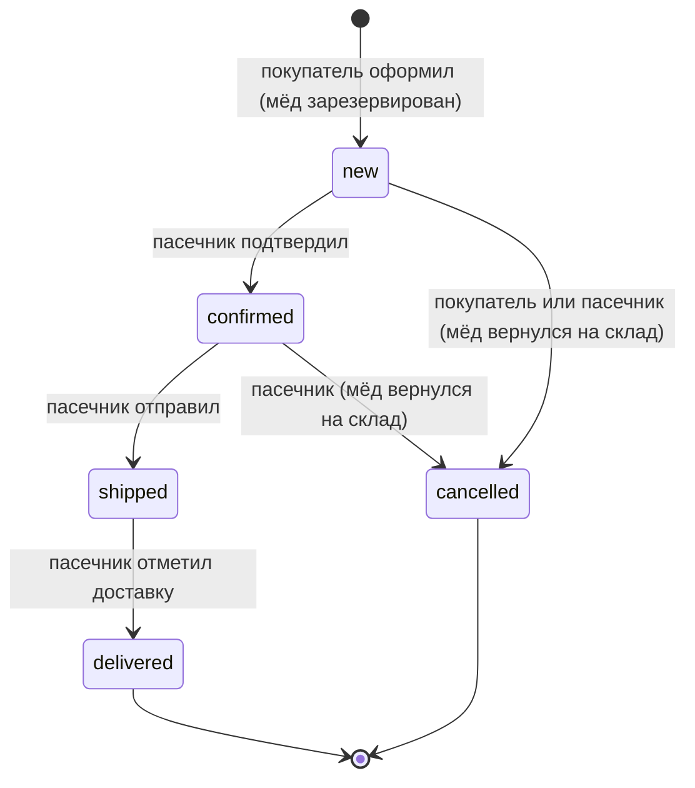
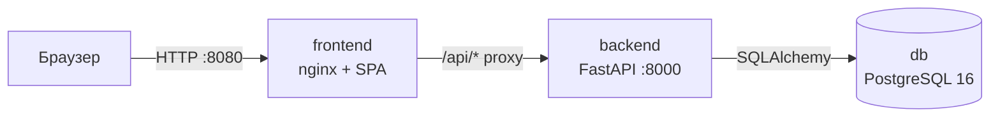

# «Лепсинский мёд» — описание проекта

## 1. Идея

**«Лепсинский мёд»** — интернет-магазин мёда с семейных пасек села Лепсинск (Сарканский район, область Жетысу, Казахстан).
Село стоит на реке Лепсы у подножия Джунгарского Алатау. Его основали казаки в середине XIX века, и пчеловодство
здесь — давняя семейная традиция. Летом пчёл вывозят на альпийские луга на высоту до 1800 метров,
поэтому местный мёд получается густым и ароматным, а сорта сильно отличаются друг от друга.

> Проект учебный. Пасека, товары, цены и демо-заказ вымышлены и служат примером данных.

### Проблема

Небольшие пасеки продают мёд «по знакомым», на рынке или через мессенджеры. Покупателю из другого города
сложно понять, чем горный мёд отличается от лугового, есть ли нужный сорт в наличии и сколько будет стоить
доставка. Пасечник же ведёт заказы в блокноте, теряет остатки и не видит, какой сорт продаётся лучше.

### Решение

Веб-приложение, где:
- **покупатель** видит каталог с понятными характеристиками (вкус, сладость, яркость, высота пасеки, год сбора),
  может пройти тест-подбор мёда, собрать корзину, выбрать доставку и отслеживать статус заказа;
- **пасечник** управляет ассортиментом и остатками, ведёт заказы по статусам и видит статистику сезона.

### Чем проект интересен и уникален

- **Мёд с привязкой к месту.** У каждого товара указана высота пасеки и год сбора, а на главной странице
  рассказано о селе и о годе на пасеке — покупатель понимает происхождение продукта.
- **Подбор мёда по вкусу.** Три вопроса (вкус, повод, кто будет есть) → алгоритм сравнивает ответы
  со «вкусовым профилем» сортов (сладость и яркость по шкале 1–5) и предлагает три лучших варианта.
- **Честные остатки.** При оформлении заказа мёд резервируется на складе, при отмене возвращается.
  Купить больше, чем есть, невозможно.
- **Иллюстрации без фотографий.** Банки и соты рисуются в SVG цветом конкретного мёда — от почти белого
  донникового до тёмно-янтарного горного. Добавив товар, пасечник просто выбирает цвет.
- **Бесплатная доставка от порога.** В корзине показано, сколько осталось добрать до бесплатной доставки.

### Целевая аудитория

- жители Алматы, Талдыкоргана и других городов Казахстана, которые хотят натуральный мёд из конкретного места;
- покупатели подарков (мёд в сотах, наборы);
- сами пасечники, которым нужен простой инструмент учёта заказов.

## 2. Роли и права

| Действие | Гость | Покупатель (`user`) | Пасечник (`admin`) |
|---|:-:|:-:|:-:|
| Каталог, поиск, фильтры, карточка товара, подбор мёда | ✔ | ✔ | ✔ |
| Корзина (хранится в браузере) | ✔ | ✔ | ✔ |
| Оформление заказа | | ✔ | ✔ |
| Просмотр заказов | | свои | все |
| Изменение заказа | | свой, в статусе «Новый» | любой |
| Смена статуса | | только отмена нового | по цепочке статусов |
| Удаление заказа | | свой «Новый» или «Отменён» | любой |
| Создание / изменение / удаление товаров | | | ✔ |
| Видеть скрытые товары | | | ✔ |
| Управление пользователями, статистика | | | ✔ |

**Авторизация** — JWT. При входе сервер выдаёт токен с идентификатором пользователя и ролью, клиент передаёт
его в заголовке `Authorization: Bearer …`. Пароли хранятся в виде хеша **bcrypt**. Заблокированный пользователь
не может войти, а его токен перестаёт приниматься. Первый пасечник (`admin`) создаётся при старте
из переменных окружения.

## 3. Бизнес-сущности

Две основные бизнес-сущности с полным CRUD — **Товар** и **Заказ** — и вспомогательные «Пользователь» и «Позиция заказа».

| Сущность | Create | Read | Update | Delete |
|---|---|---|---|---|
| **Товар** | `POST /api/products` | `GET /api/products`, `GET /api/products/{id}` | `PUT /api/products/{id}` | `DELETE /api/products/{id}` |
| **Заказ** | `POST /api/orders` | `GET /api/orders`, `GET /api/orders/{id}` | `PUT /api/orders/{id}` | `DELETE /api/orders/{id}` |

В позиции заказа копируются название и цена товара: если пасечник поменяет цену или удалит товар,
старые заказы не изменятся.

### Жизненный цикл заказа

### Правила расчёта

- Стоимость доставки: самовывоз — 0 ₸, Казпочта — 1 500 ₸, курьер — 2 500 ₸.
- От 20 000 ₸ доставка бесплатная. Тарифы и порог задаются в настройках сервера и отдаются клиенту через `/api/settings`.
- Для доставки (кроме самовывоза) адрес обязателен.
- Сумма пересчитывается на сервере при каждом изменении заказа; клиенту нельзя «подсунуть» свою цену.

## 4. Архитектура

| Контейнер | Технологии | Назначение |
|---|---|---|
| `db` | PostgreSQL 16 | Хранение данных, том `pgdata`, healthcheck `pg_isready` |
| `backend` | Python 3.12, FastAPI, SQLAlchemy 2, Pydantic 2, PyJWT, bcrypt | REST API, бизнес-логика, авторизация |
| `frontend` | nginx, HTML/CSS/JS без сборки | Интерфейс и проксирование `/api/*` в backend |

Ключевые решения:
- **FastAPI** валидирует запросы через Pydantic и генерирует Swagger-документацию (`/api/docs`).
- **Таблицы создаются при старте**, демо-данные (8 товаров, покупатель `demo`, один доставленный заказ)
  добавляются, только если каталог пуст, — проект можно показывать сразу после запуска.
- **Резерв и возврат остатков** выполняются в той же транзакции, что и создание или отмена заказа.
- **Запуск без Docker.** Скрипт `run-local.bat` поднимает тот же бэкенд на SQLite и отдаёт интерфейс с того же порта.

## 5. Интерфейс

- **Главная** — горный пейзаж, история села, преимущества, «год на пасеке», популярные сорта.
- **Каталог** — поиск, сорта-чипы, сортировка, «только в наличии», карточки с банками в цвет мёда
  и шкалами сладости и яркости, подробная карточка в модальном окне.
- **Подбор мёда** — тест из трёх вопросов с прогресс-баром и тремя рекомендациями.
- **Корзина** — изменение количества, выбор доставки, подсказка до бесплатной доставки, форма получателя.
- **Мои заказы** — прогресс по статусам, изменение и отмена нового заказа.
- **Панель пасечника** — выручка, проданные килограммы, заканчивающиеся товары, хиты продаж,
  таблицы заказов, товаров и пользователей.

Вёрстка адаптивная (от 360 px), меню на телефоне сворачивается в «бургер».

## 6. Тестирование

`backend/tests/test_api.py` проходит полный сценарий: регистрация и вход, CRUD товаров с проверкой прав
и скрытых товаров, создание заказа с резервом остатков, проверка нехватки товара и обязательного адреса,
изменение заказа с пересчётом остатков и бесплатной доставкой, цепочка статусов и запрещённые переходы,
отмена с возвратом на склад, удаление, статистика, блокировка и удаление пользователя.

## 7. Развитие

Оплата через Kaspi, уведомления в WhatsApp/Telegram, трек-номера Казпочты, отзывы и рейтинг сортов,
предзаказ мёда нового сезона, лабораторные анализы, миграции схемы через Alembic, CI в GitHub Actions.
Подробно — в [USE_CASES.md](USE_CASES.md).
